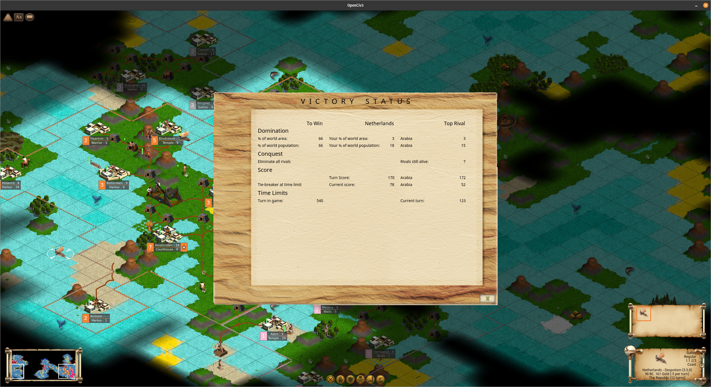

# OpenCiv3

**OpenCiv3** (formerly known by the codename "C7") is an open-source, cross-platform, mod-oriented, modernized reimagining of _Civilization III_ by the fan community. Built with the Godot Engine and C#, it has capabilities inspired by the best of the 4X genre and lessons learned from modding Civ3. Our vision is to make Civ3 as it could have been, rebuilt for today's modders and players: removing arbitary limits, fixing broken features, expanding mod capabilities, and supporting modern graphics and platforms. A game that can go beyond C3C but retain all of its gameplay and content.

***OpenCiv3 is under active development and currently in a pre-alpha state.*** It is a rudimentary playable game but lacking many mechanics and late-game content, and errors are likely. Keep up with our development for the latest updates and opportunities to contribute!

### [New Players Start Here: An Introduction to OpenCiv3 at CivFanatics](https://forums.civfanatics.com/threads/welcome-to-openciv3-new-players-start-here.674451/)

## Connect with the community

- **[CivFanatics subforum](https://forums.civfanatics.com/forums/civ3-future-development.604/)**
- **[Discord](https://discord.gg/uwxUuWhM89)**
- **[GitHub](https://github.com/C7-Game/Prototype)**

> NOTE:  
> OpenCiv3 Copyright (c) OpenCiv3 contributors  
> 
> All content is the property of the respective authors. For more information regarding the authorship of content, see the applicable source repository logs and/or credits files in the respective directories.  
> 
> OpenCiv3 seeks to be a mechanically compatible black-box reimplementation of _Civilization III_. No part or product of _Civilization III_ ships with OpenCiv3. OpenCiv3 reimplements _Civilization III_ gameplay using original code and media produced by the community, based on publicly available information and observations. OpenCiv3 provides the option to load media from the player's own locally installed copy of _Civilization III_ for a more faithful experience.  
> 
> OpenCiv3 is not affiliated with or endorsed by civfanatics.com, Firaxis Games, BreakAway Games, Hasbro Interactive, Infogrames Interactive, Atari Interactive, or Take-Two Interactive Software. CIV and CIVILIZATION are registered trademarks of Take-Two Interactive Software, Inc. All trademarks are property of their respective owners.  

# October 2026: OpenCiv3 v0.3 Dutch 2 Has Been Released!

The OpenCiv3 team is pleased to announce the second release of the v0.3 "Dutch" milestone.  This is a significant enhancement over the first "Dutch Preview 1" release, introducing many new features including the ability to win the game! A local installation of Civ3 is still recommended for a more polished experience. See the [release announcement at CivFanatics](CFC RELEASE THREAD HERE) for the full list of new features.

_OpenCiv3 Dutch 2 in standalone mode showing victory status_

## Download

Download the appropriate zip file for your OS from **[the Dutch 2 release](https://github.com/C7-Game/Prototype/releases/tag/v0.3-dutch-2)**

All official releases of OpenCiv3 along with more detailed release notes can be found on the [GitHub releases page.](https://github.com/C7-Game/Prototype/releases/)

## Install

### System Requirements

- 64-bit Windows, Linux, or Mac OS. Other platforms may be supported in future releases.
- Minimum hardware requirements have not yet been identified. Please let us know if OpenCiv3 does not perform well on your system.
- Recommended: A locally installed copy (the game itself does NOT have to run) of _Civilization III Conquests_ or _Complete_ edition. Standalone mode is available with placeholder graphics for those who do not have a copy.
  - _Civilization III Complete_ is available for a pittance from [Steam](https://store.steampowered.com/app/3910/Sid_Meiers_Civilization_III_Complete/) or [GOG](https://www.gog.com/en/game/sid_meiers_civilization_iii_complete)

### Windows Installation

This is a Windows 64-bit executable. OpenCiv3 will look for a local installation of _Civilization III_ in the Windows registry automatically, or you may use an environment variable to point to the files.

- Download and extract the zip file
- Double-click `OpenCiv3.exe`
- If it is blocked, you may need to unblock it by
  - Right click
  - Click on Properties
  - Check the "Unblock" checkbox near the bottom buttons in the "Security" section
  - Click OK
- If your _Civilization III_ installation is not detected, you can set the environment variable `CIV3_HOME` pointing to it and restart OpenCiv3

### Linux Installation

This is an x86-64 Linux executable. You may use an environment variable to point to the files from a _Civilization III_ installation. You can just copy or mount the top-level "Sid Meier's Civilization III Complete" (Sans "Complete" if your install was from pre-Complete CDs) folder and its contents to your Linux system, or install the game via Steam or GOG.

- Download and extract the tgz file
- Set the `CIV3_HOME` environment variable to point to the Civ3 files, e.g. `export CIV3_HOME="/path/to/civ3"`
- From that same terminal where you set `CIV3_HOME`, run `OpenCiv3.x86_64`
- To make this variable permanent, add it to your `.profile` or equivalent.

### Mac Installation

This is a universal 64-bit executable, so it should run on both Intel and M1 Macs. You may use an environment variable to point to the files from a _Civilization III_ installation. You can just copy or mount the top-level "Sid Meier's Civilization III Complete" (Sans "Complete" if your install was from pre-Complete CDs) folder and its contents to your Mac system, or install the game via Steam or GOG.

- Download the zip; it may complain bitterly, and you may have to tell it to keep the download instead of trashing it
- Double click the zip file, and a folder including `OpenCiv3.app` and others will appear
- If you try to open `OpenCiv3.app` it will tell you it's damaged and try to trash it; it is not damaged
- To unblock the downloaded app, from a terminal run `xattr -cr /path/to/OpenCiv3.app`; you can avoid typing the path out by typing `xattr -cr ` and then dragging the `OpenCiv3.app` icon onto the terminal window
- Set the `CIV3_HOME` environment variable to point to the Civ3 files, e.g. `export CIV3_HOME="/path/to/civ3"`
- From that same terminal where you set `CIV3_HOME`, run `OpenCiv3.app` with `open /path/to/OpenCiv3.app`, or again just type `open ` and drag the OpenCiv3 icon onto the terminal window and press enter

## Troubleshooting and Known Issues

Compatibility

- OpenCiv3 uses many primitive placeholder assets; loading files from a local _Civilization III_ install is recommended (see platform specific setup instructions above)
- Support for playing Civ3 BIQ or SAV files is incomplete; some files will not load correctly and crashes may occur
- Likewise support for OpenCiv3 JSON files (rules and saves) is not yet stable across different versions and they may or may not be reusable.
- The Palace view is not yet supported in standalone mode; it opens an invisible overlay that can be closed by pressing Esc.

Game config and logging:
- By default OpenCiv3 expects the general config file `C7.ini` and main log file `log.txt` to exist in the same directory as the game itself and be writable. It is recommended to install the game to a writable location such as under your user home directory. If the game folder is NOT writable, **settings and logs are stored in a per-user Godot data folder instead.** Resolved paths and Civ3 install detection is now saved in `log.txt`, so it’s easier to troubleshoot if the game can’t find your Civ3 files. [See here for more details on user data folder locations.](https://docs.godotengine.org/en/stable/tutorials/io/data_paths.html#accessing-persistent-user-data-user)
- If you need to set or change the location of Civ3 later, or something goes very wrong and the game cannot launch, delete `C7.ini` and restart the game.
- If you encounter a crash, an error dialog for a reason not listed here, or other major problem that you cannot troubleshoot, find `log.txt` as described above and submit it to us in a GitHub issue or on Discord.

Mac:
  - Mac will try hard not to let you run this; it will tell you the app is damaged and can't be opened and ask to move it to Trash. From a terminal you can run `xattr -cr /path/to/OpenCiv3.app` to enable running it.
  
**Other specific bugs will be tracked on the [GitHub issues page.](https://github.com/C7-Game/Prototype/issues?q=is%3Aissue%20state%3Aopen%20label%3Abug)**

> © OpenCiv3 contributors. OpenCiv3 is free and open source software released under the [MIT License](https://opensource.org/license/mit).
